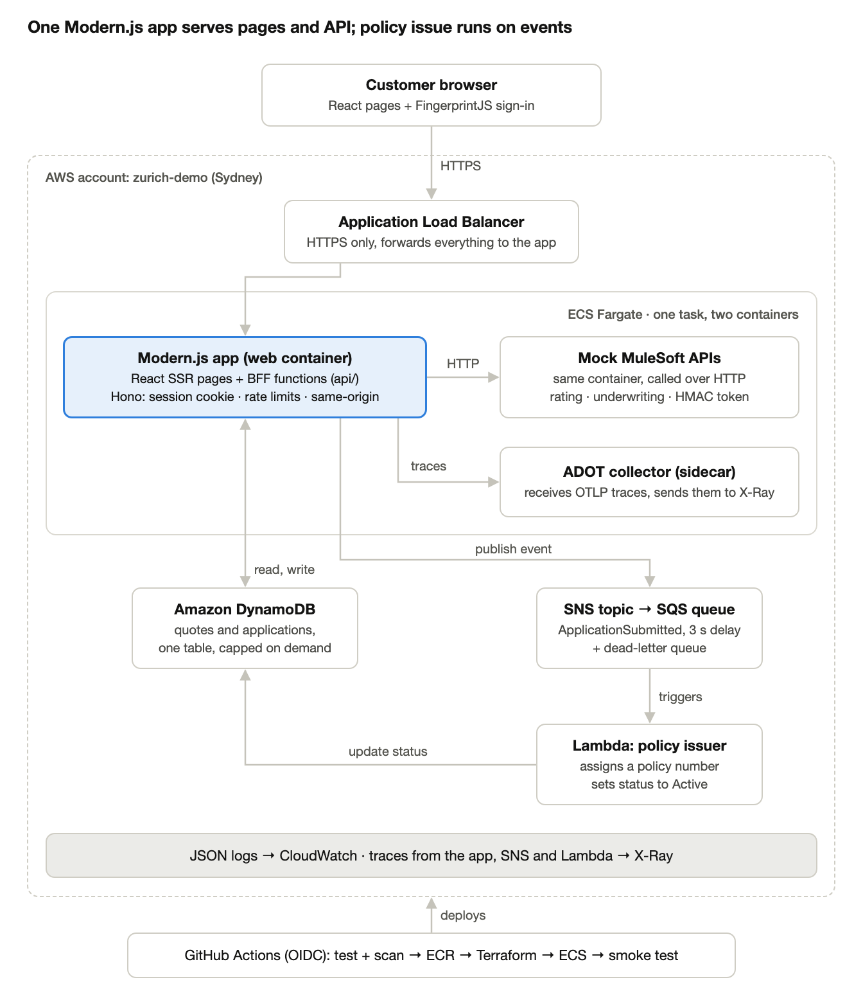

# Zurich Life Direct (demo)

Demo only, not a real Zurich product. Fake data, mock sign-in.



## Run it

```bash
pnpm install
docker compose up -d   # DynamoDB Local
pnpm dev               # http://localhost:8080
```

## Deploy

Push to main. GitHub Actions tests, scans and deploys to ECS.

## First deploy

```bash
infra/bootstrap.sh <account-id> <alert-email> 20
terraform -chdir=infra init -backend-config=backend.hcl
terraform -chdir=infra apply -target=aws_acm_certificate.app -target=aws_ecr_repository.web
pnpm build && docker buildx build --platform linux/amd64 --push -t <ecr-url>:$(git rev-parse HEAD) .
terraform -chdir=infra apply -var image_tag=$(git rev-parse HEAD)
```

Add the DNS records Terraform outputs, then set the repository variables.

## Where things are

- apps/web: Modern.js app (pages, BFF, mock MuleSoft)
- functions/policy-issuer: Lambda that activates policies
- infra: Terraform
