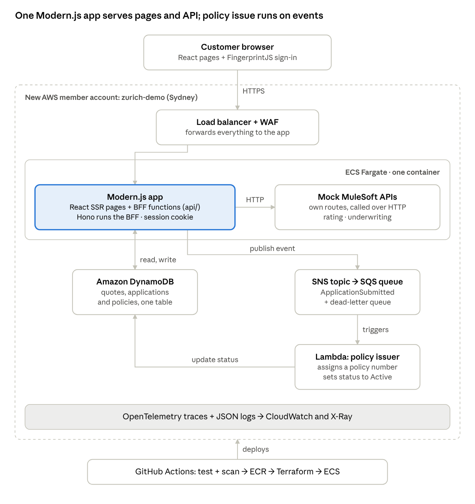

# Zurich Demo App — Product & Stack Plan

## The product: Zurich Life Direct (demo)

Build a small direct-to-customer life insurance journey. A customer gets a quote without logging in, signs in to apply and buy, then watches the policy go live on a "My policies" page. That one flow covers the demo's stack.

- **It's what Zurich Australia actually sells online.** Ezicover life and income protection is sold direct through partner pages on direct.zurich.com.au. The quote-and-apply steps behind those pages still run on an older ASP.NET site (seclife.zurich.com.au). That makes it a plausible target for a frontend, microservices, and cloud foundations demo, but treat that as a guess.
- **It covers the stack end to end:** a React/TypeScript UI with real state, a Modern.js BFF (Hono under the hood), a MuleSoft-style integration layer, a mocked sign-in, DynamoDB, SNS/SQS/Lambda, containers on AWS, CI/CD with shift-left checks, and observability.
- **It fits a small build window** if the insurance logic stays fake: a made-up rating table, four health questions, instant decisions.

## The 5-minute demo story

The demo is one customer buying cover, then a look behind the scenes at how it was built and shipped.

1. **Partner landing page.** A co-branded page for a made-up partner (say "Harbour Bank") with a "Get a quote" button.
2. **Quote in three steps, no login.** About you → choose cover (life sum insured, income protection monthly benefit) → your premium, with a bundle discount. The same Zod rules validate in the browser and the BFF.
3. **Sign in to apply.** "Apply now" asks the customer to sign in. FingerprintJS reads a browser ID, and the BFF starts a session from it, with no password. The screen labels it as a mock sign-in.
4. **Health questions and submit.** The BFF calls the mock "MuleSoft" underwriting API, saves the application and shows "Application received".
5. **Policy goes live on its own.** An event flows SNS → SQS → Lambda, and "My policies" flips from Processing to Active.
6. **Behind the scenes.** One trace across the Modern.js app → mock MuleSoft → Lambda, then the GitHub Actions run: tests, scans, deploy.

Present it as a technical demo and ask for feedback. Don't pitch it as a replacement for existing systems.

## What to build

Build steps 1–6 of the story before presenting the demo. Nothing is planned after the demo.

- [ ] Partner landing page and three-step quote, with premiums from the mock rating API
- [ ] Mock sign-in with FingerprintJS; Apply and My policies need a session
- [ ] Apply → DynamoDB → SNS → SQS → Lambda → policy Active
- [ ] Zurich look: tokens, Zurich Sans, logo, demo banner
- [ ] Unit tests plus one end-to-end happy path with an accessibility check
- [ ] Deployed to its own AWS account by a GitHub Actions pipeline, built with Terraform
- [ ] Traces and JSON logs with a correlation ID across every hop
- [ ] A one-page README and a one-page decisions file

If time runs short, skip the ECS deploy and demo locally. Keep the tests.

## Architecture



Everything the browser calls is one Modern.js app on ECS. Its BFF functions call the mock MuleSoft routes over HTTP, read and write DynamoDB, and publish an event that a Lambda turns into an active policy.

## App stack

One Modern.js app does both frontend and backend, so you don't need a separate Hono service. Modern.js runs its BFF functions on Hono under the hood ([Modern.js docs](https://modernjs.dev/guides/advanced-features/bff/frameworks.html)). Writing them demonstrates the BFF (Node.js, Hono) layer.

How the backend half works:

- Each file in `api/lambda/` becomes a route under `/api`, and the export name sets the method (`get`, `post`).
- Pages import those functions directly (`import { post } from '@api/quotes'`), and Modern.js turns the call into an HTTP request.
- `Api(Post('/quotes'), Data(schema), handler)` from `@modern-js/plugin-bff/server` validates the request body with Zod.
- The session cookie check lives in `server/modern.server.ts` as middleware, and `useHonoContext()` gives you the Hono context when you need it.
- `npx modern deploy` builds one Node server (`node .output/index`, port 8080) that serves the pages and `/api` together.

In the Basis column, **Stack** = part of the demo's target stack, **Seen** = found on Zurich Australia's site or Zurich's npm packages, **Pick** = a demo implementation choice.

| Layer | Use | Basis |
| --- | --- | --- |
| Language and runtime | TypeScript; Node.js LTS (22 or 24) | Stack: Node.js |
| Repo | pnpm workspace: `apps/web` (the Modern.js app), `functions/policy-issuer` (Lambda), `infra` (Terraform) | Pick |
| Frontend and BFF | Modern.js 3 with `@modern-js/plugin-bff` (React, Rsbuild, SSR) | Stack: "React, NextJS, ModernJS" and "BFF (Node.js, Hono)" |
| Styling | Tailwind CSS v4 + shadcn/ui, themed with Zurich colour tokens | Seen: zurich.com.au's theme |
| Brand assets | `@zurich/design-tokens`: Zurich Sans and Ogg fonts, icons, logo | Seen: Zurich Design System on npm |
| Server state | TanStack Query (polls Processing → Active) | Stack: React Query |
| Forms | React Hook Form + Zod; the same schemas in the BFF | Pick |
| Journey state | Zustand store for the multi-step quote | Pick |
| Mock sign-in | `@fingerprintjs/fingerprintjs` (open source, MIT) returns a `visitorId`; the BFF stores it in a signed HttpOnly cookie | Pick |
| Integration layer | Mock "MuleSoft" APIs as their own routes in the same app (`api/lambda/mock-mulesoft/`), called over HTTP from a base URL in config | Stack: MuleSoft |
| Data | DynamoDB, one table (AWS SDK v3); DynamoDB Local for dev | Stack: DynamoDB |
| Events | SNS topic → SQS queue with a dead-letter queue → Lambda (Node.js) | Stack: SQS, SNS, Lambda |
| Tests | Vitest + React Testing Library; Playwright end-to-end with `@axe-core/playwright` | Stack: testing, shift-left |
| Code quality | ESLint + Prettier; GitHub Copilot or similar | Stack: Copilot |

A browser fingerprint isn't real authentication, because it can be copied or spoofed. That's fine for a demo with fake data.

## Infra and delivery stack

Everything runs in a new AWS member account created under your main account just for this app, so closing that one account removes it all. Inside it: ECS Fargate for the app, Terraform for the infrastructure, GitHub Actions for the pipeline. Zurich Group named AWS its preferred cloud in 2023 ([Business Wire](https://www.businesswire.com/news/home/20230131005187/en/)), and a Zurich APAC DevOps ad lists this combination ([job ad](https://freehire.me/jobs/devops-engineer-apac-www-careers-zurich-com-ifsbzgbz), Kuala Lumpur).

**Set up the account (once, from your main account)**

1. In AWS Organizations, go to AWS accounts → Add an AWS account → Create an AWS account. If Organizations isn't on yet, create an organization first; your main account becomes its management account.
2. Name it `zurich-demo` and give it an email no other AWS account uses. That email becomes the new account's root sign-in.
3. Organizations adds an `OrganizationAccountAccessRole` to the new account. Add a CLI profile that assumes it (`role_arn = arn:aws:iam::<new-account-id>:role/OrganizationAccountAccessRole`, plus `source_profile` = your main profile).
4. In the new account, create a budget alert and the S3 bucket for Terraform state. Terraform creates everything else, including the GitHub Actions role.

**Remove it after the demo:** run `aws organizations close-account --account-id <id>` from the main account. You don't have to delete resources first. You pay for usage up to closure and get a final bill the next month; the account can be reopened for 90 days, then AWS deletes it ([AWS docs](https://docs.aws.amazon.com/accounts/latest/reference/manage-acct-closing.html)).

| Area | Use | Basis |
| --- | --- | --- |
| AWS account | New member account `zurich-demo`, region ap-southeast-2 (Sydney) | Pick: one account means one-step cleanup |
| Containers | One Docker image for the Modern.js app (multi-stage build, runs `node .output/index`) | Stack: Docker |
| Compute | ECS Fargate, one service | The APAC ad says ECS, and ECS has no per-cluster fee |
| Edge | Application Load Balancer + AWS WAF | Seen: Zurich AU sites sit behind a WAF (Imperva) |
| Infrastructure as code | Terraform, state in S3 in the new account | Seen: APAC ad, "AWS using Terraform" |
| CI/CD | GitHub Actions with an OIDC role in the new account (no stored keys) → build → ECR → Terraform → ECS deploy | Seen: APAC ad, GitHub Actions |
| Shift-left scans | Trivy (image and Terraform), gitleaks (secrets), `npm audit` | Seen: the APAC ad lists SonarQube, Veracode and Prisma Cloud; these are free stand-ins |
| Secrets | SSM Parameter Store for the cookie signing key; least-privilege IAM task role | Pick |
| Observability | OpenTelemetry → CloudWatch and X-Ray; `pino` JSON logs with a correlation ID | Pick: AWS-native, nothing extra to sign up for |
| Cost guard | AWS Budgets alert in the new account | Pick |

Local dev runs fully offline: the Modern.js app plus DynamoDB Local in Docker Compose. Instead of SNS and SQS, the app calls the policy-issuer code in-process after a short delay, so policies still go Processing → Active on your machine and in CI.

## Zurich branding

Get the look from Zurich's own published design-system packages, not from scraping the website, and make it obvious the app is a demo. The colours below are the exact values in zurich.com.au's theme.

| Token | Hex | Use |
| --- | --- | --- |
| Zurich Blue | #2167AE | Primary buttons, links, hero bands |
| Dark Blue | #23366F | Body text, headings, footer (instead of black) |
| Mid Blue | #5495CF | Secondary accents |
| Light Blue | #91BFE3 | Soft backgrounds, illustrations |
| Sky Blue | #1FB1E6 | Info states |
| Sand Stone | #DAD2BD | Warm neutral panels |
| Dove | #DDE4E3 | Cool neutral panels |
| Zurich White | #ECEEEF | Page sections |
| Moss | #3A8367 | Success |
| Lemon | #F9E547 | Warning |
| Peach | #FD7C6D | Error |

- **Type:** Zurich Sans (weights 300–700) for everything, Ogg only for big display headings. Both ship inside [`@zurich/design-tokens`](https://www.npmjs.com/package/@zurich/design-tokens). The site's hero H1 is 48px at weight 300.
- **Logo and icons:** take them from the same packages (the `div[z-logo]` style in `@zurich/css-components`); don't download the logo from the site.
- **Zurich's own rules** ([ZDS colours](https://zds.zurich.com/foundations/colors)): no more than three background colours per page, Zurich Blue always visible, blue rather than black for text.

**Guardrails**

- Invent the product names, prices, partner and PDS text, and use fake customer data. Don't copy Ezicover copy or rates.
- Show a "Demo, not a real Zurich product" banner and set `noindex`.
- Keep the repo private, put the deployed URL behind a WAF IP allowlist (the mock sign-in protects nothing), and close the account after the demo. A Zurich-branded insurance site on an open URL can be mistaken for the real one.
- Get organizational approval before putting it on company systems or GitHub organizations.

## Build plan

Set up the account, skeleton and screens first; then wire up the AWS services and deploy.

**1. Setup**

- [ ] Create the `zurich-demo` member account, CLI profile, budget alert and Terraform state bucket
- [ ] Private repo with the pnpm workspace; scaffold Modern.js (`npx @modern-js/create`) and add `@modern-js/plugin-bff`
- [ ] Tailwind v4, shadcn/ui, Zurich tokens, fonts, logo, demo banner

**2. Quote journey**

- [ ] Mock MuleSoft routes for rating and underwriting, with a latency switch
- [ ] Partner landing page and the three-step quote (React Hook Form + Zod + Zustand), backed by a `POST /api/quotes` BFF function

**3. Applications and events**

- [ ] Terraform for DynamoDB, SNS, SQS + dead-letter queue, Lambda, ECR
- [ ] FingerprintJS mock sign-in, signed session cookie, and session-check middleware on Apply and My policies
- [ ] Apply → DynamoDB → SNS → SQS → Lambda → Active; My policies polls with TanStack Query
- [ ] Vitest unit tests and one Playwright happy path with axe

**4. Deployment**

- [ ] Dockerfile; Terraform for VPC, ALB, WAF and the ECS service; first deploy
- [ ] GitHub Actions: lint, test, Trivy, gitleaks, build, push to ECR, Terraform apply, deploy
- [ ] OpenTelemetry and JSON logs; check one trace end to end
- [ ] README and decisions file (next section)
- [ ] Rehearse the 5-minute demo and record a backup video

## README and docs

The repo has two docs, `README.md` and `docs/decisions.md`, and each fits on one screen. If AI drafts them, cut the draft in half before committing.

- No badges, emoji, "Features" lists, or an "Overview" that repeats the title
- Sentences under 20 words; no section longer than five lines
- Commands are copy-paste ready
- Anything not needed to run or understand the demo stays out

The whole README:

```markdown
# Zurich Life Direct (demo)

Demo only, not a real Zurich product. Fake data, mock sign-in.


## Run it

~~~bash
pnpm install
docker compose up -d   # DynamoDB Local
pnpm dev               # http://localhost:8080
~~~

## Deploy

Push to main. GitHub Actions tests, scans and deploys to ECS.

## Where things are

- apps/web: Modern.js app (pages, BFF, mock MuleSoft)
- functions/policy-issuer: Lambda that activates policies
- infra: Terraform
```

The whole `docs/decisions.md`, one line per decision:

- Modern.js BFF, not a separate Hono service: one deployable, and it runs on Hono anyway.
- FingerprintJS mock sign-in: no identity provider to set up for a demo. Not real auth.
- ECS Fargate, not EKS: no cluster to run for a demo.
- Own AWS account: closing it removes everything.

## Sources

- Zurich Australia's live sites, inspected in a browser on 21 Oct 2026: zurich.com.au, direct.zurich.com.au, seclife.zurich.com.au, web.edge.zurich.com.au
- [Zurich Australia llms.txt](https://www.zurich.com.au/llms.txt) (products, portals, brands)
- [Ezicover partner page](https://direct.zurich.com.au/anz)
- [ZDS colours](https://zds.zurich.com/foundations/colors) and [ZDS typography](https://zds.zurich.com/0.6.3/foundations/typography)
- [@zurich/design-tokens on npm](https://www.npmjs.com/package/@zurich/design-tokens)
- Modern.js: [BFF runtime (Hono)](https://modernjs.dev/guides/advanced-features/bff/frameworks.html), [BFF functions](https://modernjs.dev/guides/advanced-features/bff/function.html), [extending the BFF server](https://modernjs.dev/guides/advanced-features/bff/extend-server.html), [deploy](https://modernjs.dev/guides/basic-features/deploy.html)
- [FingerprintJS (open source)](https://github.com/fingerprintjs/fingerprintjs)
- AWS: [creating a member account](https://docs.aws.amazon.com/organizations/latest/userguide/orgs_manage_accounts_create.html), [closing a member account](https://docs.aws.amazon.com/organizations/latest/userguide/orgs_manage_accounts_close.html), [what closing does](https://docs.aws.amazon.com/accounts/latest/reference/manage-acct-closing.html)
- [Zurich and AWS, 2023](https://www.businesswire.com/news/home/20230131005187/en/)
- [Zurich APAC DevOps Engineer ad](https://freehire.me/jobs/devops-engineer-apac-www-careers-zurich-com-ifsbzgbz)
