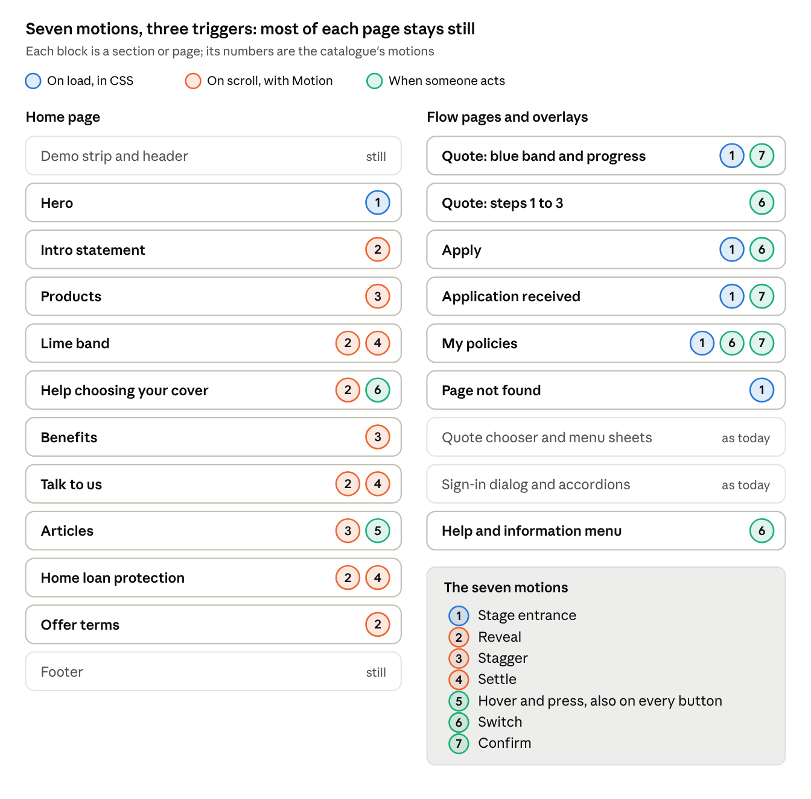

# Zurich Demo App — Phase 3 Plan: Motion

## The goal

Add a small, consistent set of animations so the redesign feels finished and alive, without changing what any page says or how the flow works. Restraint is the rule: each animation has to help someone notice, follow or get feedback, and none can hold back content or call attention to itself.

Rules this plan sets (change any you disagree with):

- **A few patterns, reused.** A handful of named motions used everywhere, not a new effect per section.
- **Short and small.** Most moves finish in a fraction of a second and travel a short distance. Only opacity and transform animate.
- **Once, not forever.** Things animate when they first appear or when someone acts. Nothing loops, bounces or auto-plays.
- **Content first.** Every page reads correctly with animation off: with reduced motion, without JavaScript, and in tests.

**Out of scope:** parallax, scroll-jacking, pinned scroll scenes, number counters, carousels, page-transition choreography, cursor effects, 3D and Lottie.

## What moves today

The demo already has a few small motions, all switched off for people who ask for reduced motion. zurich.com.au moves more than it seems: its hero has a choreographed entrance, and its card rows rise in as you scroll to them. Phase 3 builds on both.

**In the demo now** (all behind Tailwind's `motion-safe:`):

| Where | What it does |
| --- | --- |
| Home hero and flow-page bands | The shapes slide in 72px and fade, copied from zurich.com.au |
| Quote chooser and mobile menu | The sheet slides in from the right and out again, with an eased start and finish |
| Sign-in dialog | Fades and grows from 95% |
| Offer terms and footer accordions | Open and close by height; the footer chevrons turn |
| Buttons and quote chooser cards | Colour and shadow change on hover; the chooser's arrow nudges right |
| Loading panels and a Processing policy | A soft pulse while waiting |

Nothing animates when you scroll, when the cover tabs switch, between quote steps, or when a policy becomes active.

**On zurich.com.au** (measured from the saved page's CSS and scripts):

- **Hero entrance:** the photo zooms in over 0.6s. The shapes slide in from 0.1s. From 0.4s, the headline rises 64px, the subline 30px and the button 24px, each over 0.5s.
- **Card rows:** when a row of up to three cards is 10% on screen, each card fades in and rises 120px over 0.6s, 0.2s after the one before. This only happens on desktop, and only once.
- **Easing:** every entrance uses one strong ease-out, `cubic-bezier(0, 0, 0, 1)`: fast at first, then a long, soft settle.
- **Reduced motion:** the hero's animations are cut to almost zero, and the card rows don't animate at all.

Zurich's design system package, already installed, has no motion tokens. Its components use 0.2s ease-in-out transitions for hover and state changes.

## Motion language

Every animation uses one of a few named values, taken from zurich.com.au where it has one. They live as tokens in `globals.css` (for CSS) and a small `motion/tokens.ts` (for Motion), so the two never drift.

| Token | Value | Used for | Source |
| --- | --- | --- | --- |
| Ease, entrance | `cubic-bezier(0, 0, 0, 1)` | Every entrance and reveal | zurich.com.au |
| Ease, sheets | The demo's existing sheet curves | Sheets and the dialog | The demo |
| Ease, state | `ease-in-out` | Hover, colour and state changes | Zurich's design system |
| Press | 100ms | A button being pressed | New |
| State | 200ms | Hover, colour and state changes | Zurich's design system |
| Switch | 250ms in, 150ms out | Tab panels, quote steps, menus | New |
| Enter | 500ms | Hero text and sections | zurich.com.au |
| Settle | 600ms | Cards and photos | zurich.com.au |
| Stagger | 120ms | Each card after the one before | zurich.com.au uses 200ms; shorter, so a row of three is done inside 0.85s |
| Rise | 32px | Sections and cards | zurich.com.au uses 120px; this is quieter |
| Hero rise | 64px, 30px, 24px | Headline, bullets, button | zurich.com.au |
| Photo settle | Scale 1.06 to 1 inside its frame, no fade | Hero, lime band and promo photos | zurich.com.au zooms from 1.3 with a fade; no fade keeps the hero photo's load time honest |
| Nudge | 4px | Arrows on hover | The quote chooser's cards |
| Trigger | 10% on screen, ignoring the bottom tenth; once | Every reveal | zurich.com.au |

Three limits hold everywhere:

- No single animation runs longer than 600ms, and nothing is still moving 1 second after it started.
- Only opacity and transform animate, so nothing reflows and nothing shifts the layout.
- **On phones** (below 768px), sections and cards fade in place: no rise and no stagger.

**Reduced motion:** when someone's device asks for less motion, nothing moves. Entrances and reveals show at once. State changes, like a tab switching, may crossfade for up to 150ms.

## Library choice

**Decision: CSS for anything that plays on page load, on hover or on a state change; Motion for scroll reveals, staggered card rows and the quote steps' exit; no GSAP.** Each tool does the part it's best at, and the page still works if the JavaScript is slow or fails.

|  | CSS and Tailwind (installed) | [Motion for React](https://motion.dev/docs/react) 14.6 | [GSAP](https://gsap.com) 3.15 with `@gsap/react` |
| --- | --- | --- | --- |
| Extra JavaScript | None | About 5 KB at first render with `LazyMotion` and `m`; about 24 KB more of features, which can load after the page is up | Larger; scroll triggers are a separate plugin |
| Plays before React takes over the page | Yes | No | No |
| Animates something being removed | No | Yes (`AnimatePresence`) | Yes, by hand |
| Scroll reveals with a stagger | Needs a small hand-written observer | Built in (`whileInView`, `stagger`) | Built in (ScrollTrigger) |
| Fits this codebase | Already used for every motion today | Props on components, like the rest of the React code | Imperative timelines run from refs and effects |
| Reduced motion | `motion-safe:` | `useReducedMotion` and `MotionConfig` | Handled by hand |
| Licence | Free | Free (MIT) | Free, including every plugin, since 3.13 |

GSAP is the stronger tool for long, choreographed timelines and scenes that follow the scroll bar. This plan has neither, on purpose. Motion covers the three things CSS can't do cleanly, at a fraction of the weight, and its features load after the page is already visible.

CSS [scroll-driven animations](https://webkit.org/blog/17101/a-guide-to-scroll-driven-animations-with-just-css/) were also ruled out. They tie progress to the scroll bar instead of playing once, and browser support is still uneven.

## The animation catalogue

Seven motions cover the whole site. Each has one job, and the same motion looks the same wherever it appears.

| Motion | Where | When it plays | What it does | With reduced motion |
| --- | --- | --- | --- | --- |
| 1. Stage entrance | Home hero; the blue band on the quote, apply and My policies pages; the received and 404 cards | On load, in CSS, before any JavaScript | Hero photo settles from 1.06 inside its frame. Shapes slide in as now. Headline (from 10% opacity), bullets and button fade and rise 64px, 30px and 24px over 500ms, starting at 0.2s (zurich.com.au waits 0.4s). Bands and cards rise 32px | Everything in place at once |
| 2. Reveal | Intro statement, lime band text, cover tabs, Talk to us and Home loan cards, offer terms | The first time 10% of it is on screen | Fades in and rises 32px over 600ms. Anything already on screen at load stays put | Shown at once |
| 3. Stagger | The product cards, the benefits and the article cards, each row led by its heading | As Reveal | Reveal, each item 120ms after the one before. Desktop only: on phones each card fades in as it arrives | Shown at once |
| 4. Settle | The lime band's round photo and shapes; the promo cards' photos | With its section's reveal | Photo scales from 1.06 to 1 inside its frame over 600ms. The lime band's shapes slide in like the hero's | No movement |
| 5. Hover and press | Buttons, quote chooser cards, article cards | Hover and press | Buttons dip to 98% while pressed. Arrows nudge 4px their way. Article photos ease to 1.04 inside their frame | Colour and shadow only |
| 6. Switch | Cover tabs, quote steps, loading panels, the Help & information menu | When someone acts, or data arrives | A tab's panel fades in over 250ms, its text rising 8px. A quote step fades out in 150ms and the next fades in over 250ms, sliding 24px from the way you're going. Loaded content fades in over 200ms. The Help menu fades in, dropping 8px | Opacity only, 150ms at most |
| 7. Confirm | Quote progress, My policies status, application received | A step is done; a policy turns active while the page is open; the received page opens | The progress tick pops in with a small spring and the line to the next step fills. The status pill crossfades and its tick pops. The received icon pops once the card has landed | Instant swap |

**Kept as they are:** the sheets, sign-in dialog, accordions, chevrons and loading pulses. They already follow reduced motion.

**Not animated:**

- the header, footer and demo strip
- form fields, labels, hints and error messages (errors appear at once)
- text inside a paragraph: no letter or word effects
- numbers and prices: no counting up
- anything tied to the scroll position: no parallax
- moving from one page to another
- focus rings, and the hero photo's opacity

## Motion map

The header and footer never move, and no block has more than three motions. Everything that plays on load is CSS, scroll motions use Motion, and actions use whichever is simpler.

## Guardrails

Animation must never cost content, accessibility or speed. These rules are tested, not just intended.

**Server rendering.** The site's HTML is rendered on the server and streamed, so it shows before React takes over.

- The server's HTML is always fully visible. Only the CSS stage entrances play before JavaScript runs, and they need nothing but the stylesheet.
- A scroll reveal hides something only after React has taken over, and only while it is still below the screen. A slow or failed script can never leave content invisible, and nothing already on screen flickers.

**Accessibility.**

- Reduced motion works as the motion language section says, on every page.
- Someone who tabs into a section that hasn't revealed yet sees it at once. Animation never moves or delays the element that has focus, and each quote step still moves focus to its heading.
- Content waiting to reveal is transparent, not removed, so screen readers still read the page in order.
- Nothing loops or runs past 1 second, apart from the loading pulses, which stop when the content arrives. Reduced motion meets [WCAG 2.3.3, Animation from Interactions](https://w3.org/WAI/WCAG21/Understanding/animation-from-interactions).
- Colour contrast is checked after animations finish, as the tests already do for the sign-in dialog.

**Performance budgets.**

- The home page's JavaScript at first load grows by 10 KB gzipped at most. Motion's features load after the page is visible.
- On desktop the hero photo is the page's [Largest Contentful Paint](https://www.debugbear.com/blog/opacity-animation-poor-lcp); on phones, where the photo starts near the bottom of the screen, the headline may be. Neither starts transparent, because Chrome doesn't count transparent paints: the photo only scales, and the headline fades up from 10% opacity. LCP is no worse than before on desktop or mobile (Lighthouse, median of 3 runs).
- Layout shift stays where it is today, because only transform and opacity animate.
- Reveals stay smooth with Chrome DevTools' 4× CPU slowdown. No permanent `will-change`.

## Build plan and definition of done

Claude Code builds this in four steps. After each one it stops, saves short screen recordings at 1440px and 375px to `doc/Phase 3/recordings/`, and reports what to look at.

1. **Foundations.** Install Motion, add the tokens, the motion provider, the reveal and stagger building blocks and the CSS stage entrance. A temporary lab page shows all seven motions side by side.
2. **Home page.** Stage entrance, reveals, staggers, settles, and hover and press, section by section.
3. **Flow and controls.** Cover tab switching, quote steps, loading panels, the Help menu, quote progress, policy status, and the received and 404 cards.
4. **Finish.** Tests, the budget checks, README and decisions; delete the lab page. Deploy only when you say so, by pushing to main.

**Tests added:**

- With JavaScript turned off, every home-page section is visible.
- After scrolling the home page to the end, nothing is left transparent.
- With reduced motion, the hero and the first sections are fully visible at once, and nothing has moved.
- Each quote step still moves focus to its heading, with motion on.
- The server's render of a reveal carries no hidden styles.
- Every existing unit, E2E and accessibility test still passes.

**Done when:**

- [ ] The seven motions are in place, and nothing else moves
- [ ] Every animation uses the tokens, and none runs longer than 600ms
- [ ] With reduced motion, nothing moves on any page
- [ ] With JavaScript off, every section is visible
- [ ] LCP and layout shift are no worse, on desktop or mobile
- [ ] First-load JavaScript has grown by 10 KB gzipped at most
- [ ] `pnpm lint`, `typecheck`, `test` and `e2e` pass locally and in CI
- [ ] README and `docs/decisions.md` are updated, and each still fits on one screen

**Talking points for the demo:**

- The timing and easing come from zurich.com.au's own stylesheet.
- Motion switches off for anyone whose device asks for less, and no content waits on JavaScript.
- CSS where it's enough, a library only where it adds something, and no layout shift.

## Sources

- The demo's code on main (commit `fa66ba4`), read 23 Oct 2026, and the running site at 1440px and 375px
- Your saved zurich.com.au page: `doc/Zurich Australia/`. Timings, easing and triggers come from its stylesheet (`818c46e31f6e4240.css`) and main script (`182-01a4ac0de0fb5e11.js`), read 23 Oct 2026
- Zurich's design system packages in the repo: `@zurich/design-tokens` and `@zurich/css-components` 0.8.1
- Motion: [reduce bundle size](https://motion.dev/docs/react-reduce-bundle-size), [accessibility](https://motion.dev/docs/react-accessibility), [scroll animations](https://motion.dev/docs/react-scroll-animations), [changelog](https://motion.dev/changelog?type=major); `motion` 14.6.0 on npm, published 22 Oct 2026
- GSAP: [3.15 README](https://cdn.jsdelivr.net/npm/gsap@3.15.0/README.md), [3.13 README](https://app.unpkg.com/gsap@3.13.0/files/README.md) (free, including all plugins), [GreenSock's React guidance](https://tessl.io/registry/skills/github/greensock/gsap-skills/gsap-react)
- WebKit: [scroll-driven animations with just CSS](https://webkit.org/blog/17101/a-guide-to-scroll-driven-animations-with-just-css/)
- DebugBear: [opacity animations and LCP](https://www.debugbear.com/blog/opacity-animation-poor-lcp)
- W3C: [Understanding 2.3.3, Animation from Interactions](https://w3.org/WAI/WCAG21/Understanding/animation-from-interactions)
- Phase 1 and Phase 2 plans and briefs: `doc/Phase 1/`, `doc/Phase 2/`
