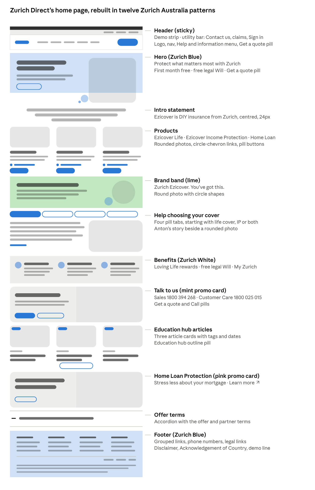

# Zurich Demo App — Phase 2 Plan: Zurich Direct, Redesigned

## The goal

Turn the demo's public pages into "Zurich Direct, redesigned": every content block from today's direct.zurich.com.au home page, rebuilt in zurich.com.au's newer design language. The quote, apply and My policies flow keeps its structure and behaviour. It only picks up the new header, footer and rounder components.

Decisions this plan makes (change any you disagree with):

- **The site becomes Zurich Direct.** The Harbour Bank co-branding goes, and the app is renamed "Zurich Direct (demo)".
- **Only the home page is rebuilt.** The product pages, FAQs, claims, contact and Education hub articles weren't saved, so those links open the real Zurich page in a new tab, marked as external.
- **Real Zurich Direct copy and photos are used,** taken from your saved page and your screenshots of the four tabs.
- **The site stays public.** The demo strip on every page, the footer's "design concept" line, the labelled mock sign-in and `noindex` make it clear this isn't the real Zurich Direct.
- **Mobile follows zurich.com.au's mobile page.** Your mobile screenshots set the patterns, listed under "Mobile" below.

## What the demo has today

The front page is three short sections in a narrow 1024px column. The application flow behind it works end to end and stays.

- **Home page:** a Zurich White hero with one button, two cover cards and a three-step "How it works".
- **Header:** logo with a "with Harbour Bank" lockup and three small text buttons. No utility bar, no menu.
- **Footer:** two lines of demo text on Zurich White.
- **Look:** 4px corners (buttons about 6px), 16px body text, the whole hero headline in Ogg, a lemon demo strip.
- **Flow:** three quote steps, the FingerprintJS sign-in dialog, apply, received and My policies, all with E2E and axe tests.

## Zurich Direct content inventory

The saved Zurich Direct home page has twelve blocks, and all twelve carry over. Copy is taken word for word from `docs/reference/Zurich Direct/Zurich Direct.html`.

| # | Block on Zurich Direct today | What it says | Where it goes |
| --- | --- | --- | --- |
| 1 | Header | Hamburger menu with 13 links, Contact Us, Get a quote, logo on the right | New header |
| 2 | Get a quote pop-up | "Need life insurance only or both life insurance and income protection?" 5% off Income Protection when bought with Life. Three quote options | Quote chooser drawer |
| 3 | Hero | "Protect what matters most with Zurich". First month free on Ezicover Life and Income Protection. A complimentary legal Will (RRP AU$159.00)\* | Hero |
| 4 | Products | "Choose the product that suits your needs": Ezicover Life Insurance, Ezicover Income Protection, Zurich Home Loan Protection, each with a teaser line, description, Learn more link and button | Product cards |
| 5 | Tabs | Life cover, income protection, or both? / Key considerations for couples / When to review your life insurance / Understanding life insurance underwriting. Each has a bold opening line, four or five numbered points, a Learn more link and its own photo | Help choosing your cover |
| 6 | Benefits | "Get more out of your life and income insurance": Loving Life rewards, complimentary Will from Willed, access to My Zurich | Benefits row |
| 7 | Talk to us | "Want to talk to us?" Sales 1800 394 268, Customer Care 1800 025 015, Get a quote and Call buttons | Mint promo card |
| 8 | Brand statement | "Zurich Ezicover. You've got this." Two paragraphs on DIY insurance | Intro statement and lime band |
| 9 | Articles | "Protect those who matter most": three Education hub articles (two on Wills, one on protection) and an Education hub button | Article cards |
| 10 | Home Loan Protection promo | "Stress less about your mortgage with Zurich Home Loan Protection." Learn more | Pink promo card |
| 11 | Offer terms | Accordion with the Will and Loving Life offer terms, partners and privacy link | Accordion |
| 12 | Footer | Nine info links, Legal, Privacy, Disclaimer, the Ezicover disclaimer, © 2026 Zurich Australia | New footer |

**Tabs:** the first tab's text is in the saved page. Tabs 2–4 come from your screenshots in `docs/reference/Zurich Direct/Tabs/`, with their photos saved alongside and their Learn more links in the brief. The photos are 350×437, the size Zurich Direct serves them, so they're never shown larger than that.

## Zurich Australia's design language

zurich.com.au is rounder, bigger and more colourful than the demo. It uses pill buttons, a Zurich Blue hero with a rounded photo, 20px copy, colour-block promo cards and a full Zurich Blue footer. The values below were measured from the saved page and its screenshot.

| Element | Demo today | zurich.com.au | Phase 2 |
| --- | --- | --- | --- |
| Page width | 1024px column | 1110px content (1158px container, 24px padding) | Match |
| Body copy | 16px | 16px base; section copy 20px / 30px line height | 20px on marketing pages, 16px in forms |
| Hero | Zurich White band, dark text, small button | Zurich Blue band. White 60px light headline (44px on mobile). White pill button. Square photo with 24px corners overlapping the band's bottom edge. Small circle shapes beside it | Match |
| Headlines | Whole H1 in Ogg | Zurich Sans, with one emphasis word in Ogg ("we *care*", "made it *possible*") | Headline component with an Ogg emphasis word |
| Section headings | 24–30px light | 36px medium (44px light for lists like Latest news) | Match |
| Buttons | About 6px corners, 16px medium | Fully rounded pills, 48px tall, 18px regular, small shadow. Primary Zurich Blue, white on blue, and a 2px outline | All three variants |
| Links | Plain text | 20px Zurich Blue with a 24px blue circle-chevron icon | Icon link component |
| Cards | 1px Dove outline, small corners | No outline. Photo with 16px corners, 32px medium title, link, pill | Match |
| Promo cards | None | 24px-corner split card: colour panel (mint, pink, light blue) beside a photo, button at the bottom left | Promo card component |
| Colour bands | Zurich White only | Lime, mint, powder pink, Zurich White and Zurich Blue sections | Add Lime #E1EE92, Mint #A6E9AB, Powder Pink #FFC5EA |
| Lists | None | White cards with 16px corners and a soft shadow, 14px date, 18px semibold title | Article cards |
| Header | One row: logo, Harbour Bank, small buttons | Zurich White utility bar (14px links: Contact us, Make a claim, Login) over a 64px white bar: logo left, 16px Dark Blue nav with a 2px underline on hover. Sticky | Match |
| Quick quote | Button goes straight to /quote | Right-hand drawer with full-width 56px pill links | Quote chooser drawer |
| Footer | Two lines on Zurich White | Zurich Blue, 64px padding. Grouped links under 16px headings, social icons in circles, divider, legal links, disclaimer, Acknowledgement of Country, copyright | Match, with Zurich Direct's links |
| Form inputs | 4px corners | Not on the home page | 8px corners, same height |
| Demo strip | Lemon strip | None | Keep it always visible; restyle as a Dark Blue strip with a Lemon "Demo" tag |

Phase 1's "no more than three background colours per page" rule is dropped: the live site uses at least five, and Phase 2 follows the live site.

## The new home page

The home page grows from three sections to ten, plus the new header and footer, top to bottom as drawn. Each block of Zurich Direct content goes into the zurich.com.au pattern that fits it.

The hero, products and footer follow zurich.com.au most closely. The tabs and accordion are Zurich Direct patterns, restyled with pill tabs and the new type.

## Header, footer and everything around the page

The header and footer follow zurich.com.au's layout and carry Zurich Direct's links. Anything we don't build opens the real page in a new tab.

**Demo strip.** A thin Dark Blue strip with a Lemon "Demo" tag: "Design concept, not the live Zurich Direct site. Fake data, mock sign-in." Always visible, never dismissible.

**Utility bar** (Zurich White, right-aligned 14px Zurich Blue links): Contact us ↗, Make a claim ↗, and Sign in with a person icon. Signed in, it shows "Demo customer · device 3f9a" and Sign out.

**Main bar** (white, 64px, sticky with the utility bar):

- Zurich logo on the left, linking home.
- Nav: Life insurance ↗, Income protection ↗, Home loan protection ↗, Help & information (menu), My policies.
- "Get a quote" pill on the right, which opens the quote chooser.
- Help & information opens a two-column panel. **Choosing cover:** Help choosing my cover, Why Zurich?, FAQs, Education hub. **Support:** Making a claim, Contact us, Documents & forms, COVID-19, Loving Life rewards program.
- Below 1024px: logo, Get a quote pill and a Menu button that opens a full-height sheet with every link and the sign-in state.

**Quote chooser drawer.** This is zurich.com.au's quick-quote drawer holding Zurich Direct's pop-up copy:

- It slides in from the right, 480px wide, and goes full screen on mobile.
- Heading: "Need life insurance only or both life insurance and income protection?" Below it: "Get a 5% discount on Ezicover Income Protection insurance if you purchase it with Ezicover Life Insurance."
- Two 56px pill links: "Get life insurance and income protection" and "Get life insurance only". Each starts the quote at step 1 with income protection switched on or off.
- Zurich Direct's third option, income protection on its own, is left out. The demo's rating needs life cover.

**Footer** (Zurich Blue, white text):

- **Our cover:** Ezicover Life Insurance ↗, Ezicover Income Protection ↗, Home Loan Protection ↗.
- **Help & information:** Help choosing my cover, Why Zurich?, FAQs, Education hub, COVID-19.
- **Support:** Making a claim, Contact us, Documents & forms, Loving Life rewards program.
- **Talk to us:** Sales 1800 394 268, Customer Care 1800 025 015 (tap to call).
- Then a divider, Legal, Privacy and Disclaimer links, the Ezicover disclaimer, Zurich Australia's Acknowledgement of Country, and "© 2026 Zurich Australia · Design concept, not the live Zurich Direct site."

**Pages not in this demo.** Product pages, info pages, articles, legal pages and Home Loan Protection all link to the real page. They open in a new tab with an external-link icon, and screen readers hear "opens in a new tab".

## Mobile

zurich.com.au's mobile page is the model: everything stacks in page order, photos go full width, and the footer folds up. (Your zurich.com.au mobile screenshot also caught its quick-quote panel open beside the page; that panel isn't part of the page layout.)

- **Header:** one white bar with the logo on the left, and a small Get a quote pill and a Menu button on the right. The utility links move into the menu sheet.
- **Hero:** the Zurich Blue band holds the 44px headline, the offer bullets and the white pill, with the circle shapes at its bottom-right corner. The photo sits directly under the band, full width with square corners.
- **Sections:** one column, 16px side padding, 40px between sections. Product and article photos keep their 16px corners.
- **Lime band and promo cards:** text first, then the photo. Promo cards keep their 24px corners.
- **Tabs:** the pill row scrolls sideways, as Zurich Direct's mobile tabs do, and the photo sits under the text.
- **Quote chooser and menu:** full-screen sheets, with the pills stacked.
- **Footer:** the four link groups fold into accordions with chevrons. Below them: centred legal links, the disclaimer, the Acknowledgement of Country.

## What stays the same

The application flow keeps its steps, fields, copy, validation and behaviour. The back end and infrastructure don't change.

**The flow only picks up shared changes:**

- the new demo strip, header and footer
- pill buttons (Continue, See my price, Apply now and Submit application) and 8px input corners
- its current 672px form column; it doesn't stretch to the new page width

**Three small content fixes so the flow agrees with Zurich Direct's copy:**

- The bundle discount drops from 10% to 5% in the mock rating, the cover step's "save" line and the quote summary. The E2E test's $112.60 price changes with it.
- Where the flow names a cover, it uses "Ezicover Life Insurance" and "Ezicover Income Protection".
- Optional: one line on the quote result, "Your first month is free", to match the hero offer. The price itself doesn't change.

**Unchanged:** BFF functions, mock MuleSoft, the session cookie, DynamoDB, SNS, SQS, the Lambda, Terraform and the CI/CD pipeline.

## Build plan and definition of done

Claude Code builds this in four steps. After each step it stops and shows screenshots at 1440px and 375px, next to the matching zurich.com.au screenshot.

1. **Foundations.** Colour tokens, corner radii, type scale, the 1110px container, and the button variants. Then the icon link, the Ogg-emphasis headline, promo card, tag, accordion, tabs and circle shapes, plus resized photos.
2. **Around the page.** Demo strip, header with the Help & information menu and mobile sheet, the quote chooser drawer, and the footer.
3. **Home page.** Every section from the inventory, in the order drawn above, with Zurich Direct's copy and the four tabs from your screenshots.
4. **Finish.** Flow touch-ups and the 5% discount, tests, README and decisions. Then deploy by pushing to main, once you say so.

**Done when:**

- [ ] The home page has every block in the inventory, in the new order
- [ ] At 1440px, side-by-side screenshots read as zurich.com.au's design language: hero, cards, promo cards, header, footer
- [ ] At 375px, the page follows zurich.com.au's mobile patterns: menu sheet, full-width hero photo, stacked sections, footer accordions, no sideways scrolling
- [ ] Quote → apply → My policies still passes E2E, with the new 5% prices
- [ ] axe finds no serious or critical issues on the home page, or with the drawer and menus open
- [ ] Menu, drawer, tabs and accordion all work by keyboard, and focus stays inside the drawer and sheet
- [ ] Each home-page photo is 250 KB or less, lazy-loaded below the fold, with no layout shift
- [ ] External links are marked and open in a new tab
- [ ] Every page keeps the demo strip and `noindex`
- [ ] README and `docs/decisions.md` are updated and still fit on one screen each

**Talking points for the demo** (what the redesign fixes on today's Zurich Direct page):

- Navigation shows on desktop instead of hiding behind a hamburger, and the logo moves back to the left.
- One button style instead of a mix of Dark Blue and Zurich Blue buttons.
- No white text on Mid Blue: the "You've got this" band is 3.2:1 contrast today, below the 4.5:1 that AA needs.
- Headings follow order. Today the page jumps from h3 to h5 and has an empty h5.
- Photos are resized. Today's page loads a 2.2 MB PNG and a 1.5 MB JPEG.
- The footer gains grouped links and Zurich Australia's Acknowledgement of Country.

## Sources

- Your saved Zurich Direct home page: `docs/reference/Zurich Direct/` (HTML, desktop and mobile screenshots, PDF, images), from [direct.zurich.com.au](https://direct.zurich.com.au/)
- Your screenshots of Zurich Direct's four tabs and the photos for tabs 2–4: `docs/reference/Zurich Direct/Tabs/`. The tab 2–4 Learn more links came from you.
- Your saved Zurich Australia home page: `docs/reference/Zurich Australia/` (HTML, CSS, desktop and mobile screenshots, images), from [zurich.com.au](https://www.zurich.com.au/). Sizes, radii and colours were measured from this page in Chromium on 22 Oct 2026
- The real application flow screenshots: `docs/reference/Application Flows/` (Steps 1–11)
- The current demo: its code in this repo and the deployed site, viewed 22 Oct 2026
- Phase 1 plan and brief: `docs/phases/Phase 1/`
