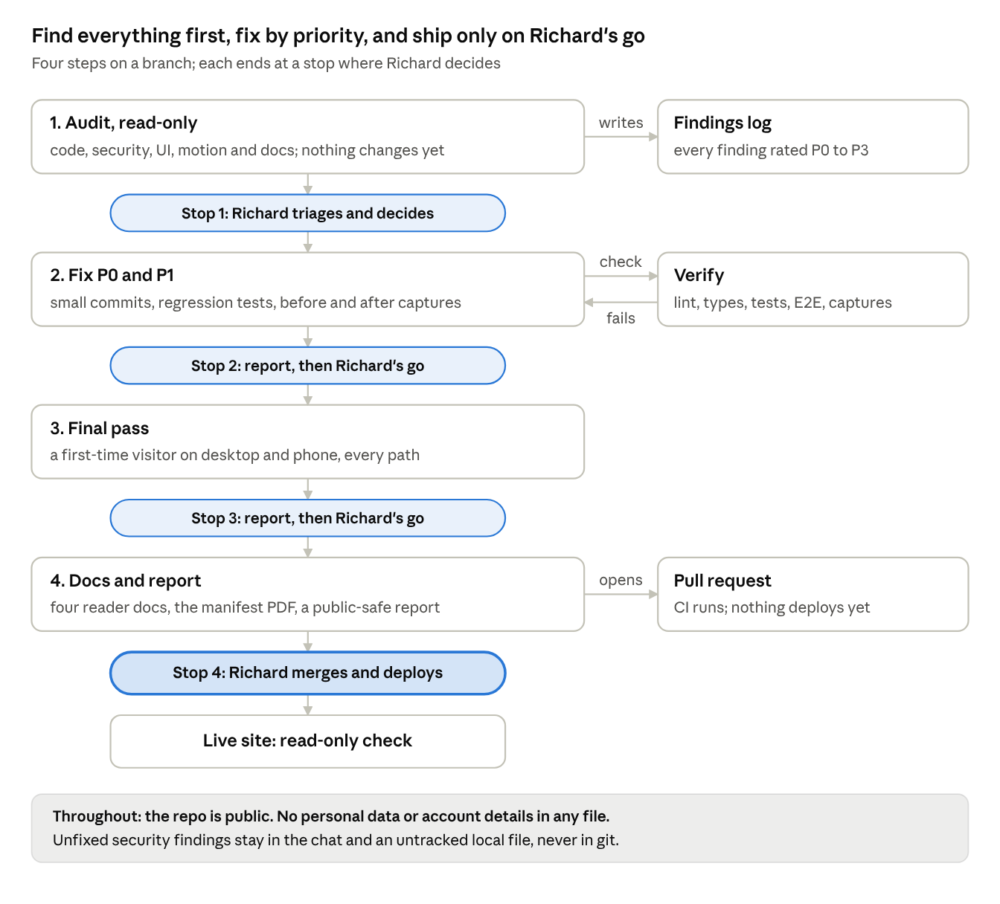

# Zurich Demo App — Phase 4 Plan: Audit and Final Polish

25 October 2026 · Richard Everley

## The goal

Phase 4 adds no features. It checks everything that's already built and fixes what's wrong, so the demo on Monday 26 October 2026 runs on a site that is correct, secure, consistent and well documented.

It covers six areas:

1. a code review for correctness
2. a security review
3. a UI audit of every page and state, rendered in real browsers at desktop and mobile widths
4. the same audit for the motion
5. the four documents people actually read: README, the AI manifest and its PDF, the architecture diagram and the decisions file
6. a final end-to-end pass of the whole app

**Every finding gets a priority**, and the priority decides what happens to it:

| Priority | Means | What happens |
| --- | --- | --- |
| P0 | Breaks the demo, loses data, or is a security risk | Fixed first |
| P1 | Visibly wrong, misleading, inaccessible or out of date | Fixed in Phase 4 |
| P2 | Polish, or a matter of taste | Fixed only if small and safe; otherwise Richard decides |
| P3 | Refactors and nice-to-haves | Logged for after the demo, not done |

**Out of scope:** new features, redesigns, dependency upgrades for their own sake, infrastructure changes, cost changes and history rewrites. Any of these needs Richard's explicit go, even when a finding seems to call for it.

**Public repo:** everything Phase 4 writes is committed to a public repository. No personal data, account IDs, IP addresses, email addresses or secrets go in any file, and no unfixed security weakness is described in enough detail to exploit.

## What we're auditing

The audit starts from `main` as deployed after Phase 3: 109 commits, CI green, the live site on Phase 3. Everything below is in scope.

| Area | What's there today |
| --- | --- |
| Pages | Home; quote steps 1 to 3; Apply; Application received (processing and referred); My policies; Page not found |
| Overlays | Quote chooser and mobile menu sheets; sign-in dialog; Help & information menu; the Apply page's info tooltip |
| Back end | BFF functions (session, quotes, applications, policies, health); mock MuleSoft (rating, underwriting); server middleware (security headers, same-origin check, rate limits, body cap, request log); the policy issuer Lambda |
| Infrastructure | Terraform for the network, load balancer, ECS Fargate with its tracing sidecar, DynamoDB, SNS to SQS to Lambda, ECR, the certificate and the GitHub OIDC role, plus Terraform tests |
| Delivery | One GitHub Actions workflow: app checks, Terraform checks, gitleaks and Trivy, and a deploy on every push to `main` |
| Tests | 79 unit tests and 27 Playwright tests with axe checks, in Chromium only |
| Reader docs | `README.md`, `docs/AI_MANIFEST.md` and its PDF, `docs/architecture.png`, `docs/decisions.md` |
| Records | `docs/phases/` (each phase's plan, brief and evidence) and `docs/reference/` (the saved Zurich pages) |

**Known and accepted; don't change them:**

- the header's 40px Get a quote pill, against 44px for every other button
- the home page's small sideways scroll at 320px wide
- with JavaScript fully off, pages stay empty: Modern.js streams them into place
- the Phase 1 to 3 documents are records. They say `doc/` (now `docs/phases/` and `docs/reference/`) and quote commit hashes from before the history rewrite. Leave them as they are, apart from a privacy fix if one is ever needed.

## How Phase 4 runs

Nothing is fixed until the whole audit is written down and Richard has triaged it, so the most important problems are fixed first. Each step ends with a report, and only Richard merges and deploys.

## Code review and correctness

Claude Code reads every tracked source file once, layer by layer. It checks behaviour against what the phase plans and briefs promised, not just style. It runs the existing checks first (`pnpm lint`, `typecheck`, `test`, `e2e`), and adds no new linters or tools without asking.

| Layer | What gets checked |
| --- | --- |
| Shared rules (`apps/web/shared`) | The browser and the BFF use the same validation; money stays in whole cents; the 5% bundle discount and the premiums add up; dates format in `en-AU` |
| BFF and mock MuleSoft (`apps/web/api`) | Every input is validated; every failure returns a friendly message and the right status, never internals; the MuleSoft token is checked; applying needs a real, unexpired quote and can't be submitted twice by accident |
| Server middleware (`apps/web/server`) | Middleware order; rate limits keyed on the real visitor behind the load balancer; the body cap on every API route; logs carry correlation IDs and no session or personal data |
| Policy issuer (`functions/policy-issuer`) | Safe to run twice for one event; bad messages end up in the dead-letter queue; local (inline) and AWS (SNS and SQS) paths behave the same |
| Front end (`apps/web/src`) | No hydration warnings or console errors; a loading, empty and error state wherever data is fetched; the quote journey survives a reload and clears after applying; no dead or leftover debug code |
| Infrastructure (`infra`) | Format, validate and Terraform tests pass; names, tags and outputs are consistent. A read-only `terraform plan` against the live account only with Richard's go |
| Delivery (`.github`, `Dockerfile`) | CI does what the README says; actions stay pinned; the image is small and runs as non-root |
| Tests | They test behaviour, not implementation; no fixed sleeps; obvious gaps are listed |

**Leads to check first** (found while writing this plan; confirm before calling them findings):

- There's a page-not-found route, but no error page. Check what a visitor sees when a page throws or the server returns a 500.
- `.gitleaksignore` names a commit and `doc/` paths that no longer exist after the move to `docs/` and the history rewrite. A full-history scan may report those findings again.
- The four `minimumReleaseAgeExclude` lines in `pnpm-workspace.yaml` were only needed while Motion 14.6.0 was under a day old.
- `components/icon-link.tsx` isn't imported anywhere.

## Security review

The review covers the app, the infrastructure, the pipeline and the repository itself, which is now public. It uses the scanners already in CI (gitleaks and Trivy) plus a manual review, and adds no new tools without asking.

| Area | Checks |
| --- | --- |
| Secrets and personal data | gitleaks over the full history, not just new commits; a search of tracked files and history for account IDs, email addresses, IP addresses, local paths and tokens; examples use placeholders and documentation IP ranges |
| Dependencies | `pnpm audit --prod`; Trivy on the filesystem and the image; every `.trivyignore` entry still needed and still justified; upgrades only for a security fix, with Richard's go |
| Web app | Session cookie flags, expiry and signature check; the same-origin check on every state-changing call; security headers and CSP on every HTML response; no personalised page cached; input validation and size limits; errors and logs reveal no internals, sessions, addresses or names; mock MuleSoft unreachable without its token; no open redirects or unescaped HTML |
| Infrastructure | Tasks reachable only through the load balancer; HTTPS only, with a current TLS policy; least privilege for the task, execution and Lambda roles; encryption at rest; log retention; an alarm on the dead-letter queue |
| Pipeline | Minimal workflow permissions; actions pinned to commit SHAs; pull requests from forks get no secrets or cloud access; nothing secret printed in logs |

**Two decisions for Richard, now that the repo is public:**

1. The GitHub deploy role trusts only `main` of this repository, but has broad permissions, justified in the code by the isolated account. Keep it, or scope it down after the demo.
2. `docs/reference/` holds saved copies of Zurich's pages: copy, photos and scripts with public browser keys. Keep them, trim them to what the docs cite, or stop committing them. Rewriting history is out of scope.

**How security findings are handled:**

- Unfixed security findings never go into a commit, pull request or issue. They're reported in the chat and kept in an untracked local file until fixed.
- A P0 security finding stops the work until Richard has seen it.
- Fix commits name the area, not the weakness, for example `fix(security): tighten session cookie flags`.
- Checks against the live site are read-only: page loads and response headers. No scanners, load tests or form submissions there without Richard's go.

## UI and motion audit

Every page and every state is rendered in real browsers, captured, and checked against one written checklist. Motion gets the same treatment, with recordings.

**Browsers and sizes.** Playwright drives Chromium (Chrome and Edge) and WebKit (Safari, including iPhone), with Firefox as a desktop spot check. Installing those browsers is a local download, not a project dependency, and CI stays on Chromium. The full matrix runs at 1440×900 and 390×844. Spot checks at 1280, 768, 375 and 320 pixels wide catch the breakpoints in between.

**What it runs against.** A local production build, including the copy whose mock MuleSoft always fails, for the error states. On the live site, only a read-only pass of the pages.

| Page | States to capture |
| --- | --- |
| Home | Top of the page; every section in view; each of the four cover tabs; offer terms open; Help & information open; quote chooser and mobile menu open; header signed in and out |
| Quote, step 1 | Empty; filled with the demo details; every validation error |
| Quote, step 2 | Life only; with income protection; sliders at their limits; working out the price; MuleSoft down |
| Quote, step 3 | Life only; with income protection |
| Sign-in dialog | Ready; signing in; failed |
| Apply | Signed out; no quote; loading; empty; validation errors; info tooltip open; submitting; failed |
| Application received | Processing; being reviewed |
| My policies | Signed out; loading; none yet; processing; active; being reviewed; failed to load |
| Page not found and errors | An unknown address; an unexpected server error |

**The checklist for every capture:**

- **Layout:** aligned to the page grid; consistent spacing; nothing hidden under the sticky header; no sideways scroll, apart from the accepted one
- **Text:** the right copy; nothing clipped or overflowing, even with large amounts
- **Controls:** one style per role; 44px buttons, apart from the header pill; hover, focus and pressed states visible
- **Images:** sharp, correctly cropped, no layout shift as they load
- **Accessibility:** axe clean; a sensible keyboard order with visible focus; usable at 200% zoom on desktop
- **Consistency and console:** a component looks the same on every page; no browser console errors or warnings

**Motion.** Record every motion in the Phase 3 catalogue at 1440 and 390 pixels wide, with motion on and with reduced motion, in Chromium and WebKit. Check that:

- nothing moves that isn't in the catalogue, and timings match the tokens
- nothing flashes or jumps while a page loads, and no animation plays twice or stacks
- reveals never leave content hidden: fast scrolling, jumping to the end, back and forward, zooming, a tab left in the background
- focus never lands on something still faded
- motion stays smooth at 4× CPU slowdown, and with reduced motion nothing moves

**Fixing.** Fix defects so they match the design rules already set in Phase 2 and Phase 3. Anything that is a matter of taste goes to Richard as before and after options, not a decision Claude Code makes.

## Reader-facing docs

Four documents are what people actually read. They're updated last, after the code fixes, so they describe the final state. Each one has to be correct, short enough to be read, and written to a professional standard.

| Document | Reader | Length | Checks |
| --- | --- | --- | --- |
| `README.md` | Anyone opening the repo | No longer than today (about 540 words); what it is and how to try it fit on the first screen | Every command works on a clean checkout; versions match `.nvmrc` and `package.json`; links and images work; the first-deploy steps are complete and in order; what it says CI does matches the workflow |
| `docs/AI_MANIFEST.md` and `AI Development Manifest.pdf` | Anyone asking how this was built with AI | One A4 page, in Richard's voice | Numbers are true at the end of Phase 4; Claude Code's section is still accurate; Richard approves any change of wording. The PDF is regenerated whenever the markdown changes. It is already behind: it still says `doc/` |
| `docs/architecture.png` | A reviewer checking how the system fits together | One image, readable at README width | Every box, label and arrow matches `infra/` and the code; nothing important is missing and nothing is out of date. Its editable source is kept beside it |
| `docs/decisions.md` | A reviewer asking why it was built this way | At most 10 lines, one decision and its reason per line | Every line is still true; overlapping lines are merged; the most important come first |

**Writing rules:** plain English, short sentences, Australian spelling, the same product names everywhere, and no personal data. No marketing language and no claims that a test or a file can't back up.

**The PDF keeps its look.** It's rendered the same way as every plan PDF: Chromium's print to PDF, A4, with the stylesheet saved as `pdf-style.css` in the Phase 4 folder. Any converter used is run temporarily, not added to the project.

**One question for Richard:** `docs/phases/Phase 3/HANDOVER.md` still says Phase 3 isn't deployed. Leave it as a record, or add a one-line note at the top that it shipped.

## Steps and definition of done

Claude Code works in four steps on a branch, and stops after each one. P0 findings come first, so stopping at any point leaves the site better than it found it. Every commit leaves the branch deployable.

1. **Audit (read-only).** Run every check, capture the full UI and motion matrix, review the code and security, and write the findings log with a priority for each finding. Stop: Richard triages the list and answers the open decisions.
2. **Fix P0 and P1.** Small commits, each with a regression test where one makes sense, and before and after captures for every UI fix. Stop and report.
3. **Final pass.** Go through the whole site as a first-time visitor on a desktop and a phone, in Chromium and WebKit: every link, back and refresh mid-journey, two tabs, sign out, the referred and failure paths. Fix what it finds, plus any P2s Richard approved. Stop and report.
4. **Docs and report.** Update the four reader-facing documents, regenerate the manifest PDF, and write a short public-safe Phase 4 report. Open a pull request so CI runs. Stop: Richard reviews, merges and deploys. After the deploy, a read-only check of the live site.

**Evidence stays small.** The repo is public, so only before and after pairs for fixed issues and a few short recordings are committed (20 MB at most in total). The full capture set stays local and untracked.

**Done when:**

- [ ] Every finding has a priority and an outcome: fixed, accepted by Richard, or logged for later
- [ ] No P0 or P1 is left open
- [ ] Every page and state in the matrix has been checked at desktop and mobile sizes, in Chromium and WebKit
- [ ] Every motion has been checked with motion on and reduced, and nothing outside the catalogue moves
- [ ] `pnpm lint`, `typecheck`, `test` and `e2e` pass locally, and CI passes on the pull request
- [ ] The full-history secret scan is clean, and no personal data or account detail is in any tracked file
- [ ] README, the manifest and its PDF, the architecture diagram and the decisions file are correct, current and within their lengths
- [ ] The Phase 4 report lists what was found and fixed, without describing any unfixed weakness

## Sources

- The repository on `main` at `14937e6` ("docs: update README"), read 25 Oct 2026: the code, `infra/`, the CI workflow, `.gitleaksignore`, `.trivyignore`, `pnpm-workspace.yaml` and the reader-facing docs
- The Phase 1 to 3 plans and briefs, and the Phase 3 handover: `docs/phases/`
- The handover notes written after Phase 3 shipped (CI, merge, deploy and the history rewrite)
